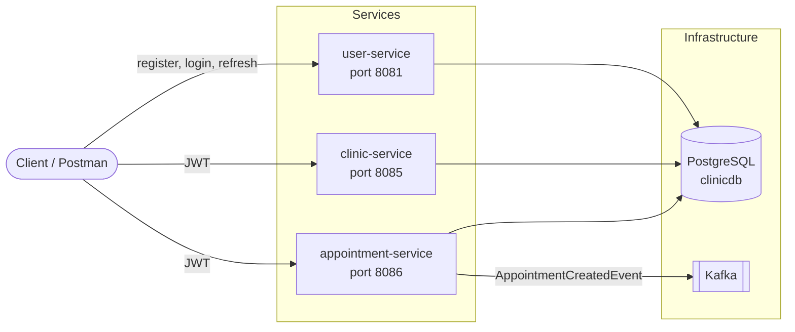

# Clinic Appointment System

A microservices-based backend for managing clinic appointments, built with Spring Boot. Patients, doctors and staff authenticate with JWT, clinics and doctors are managed in a dedicated service, and appointments are booked with conflict detection.

## Tech Stack

- Java 21, Spring Boot 4.1
- Spring Security with JWT (HS256, jjwt)
- Spring Data JPA, PostgreSQL
- Apache Kafka (appointment events, producer side)
- Gradle (multi-project build)
- Docker Compose for infrastructure

## Services

| Service | Port | Responsibility |
|---|---|---|
| user-service | 8081 | Registration, login, refresh tokens, users, roles and permissions |
| clinic-service | 8085 | Clinics, doctors and medical services |
| appointment-service | 8086 | Booking appointments with conflict detection, publishes events to Kafka |

Each service validates the JWT issued by `user-service` using a shared secret.

## Architecture



`user-service` is the only service that issues tokens. `clinic-service` and `appointment-service` validate the JWT locally with the shared secret, so no service-to-service call is needed to authenticate a request.


## Getting Started

### Prerequisites

- JDK 21
- Docker Desktop (or Docker Engine with Compose)

### 1. Configure environment variables

Copy the template and fill in your own values:

```
cp .env.example .env          # Windows: copy .env.example .env
```

`.env` is git-ignored. Set a strong `JWT_SECRET` (at least 32 bytes). One way to generate it:

```
openssl rand -base64 48
```

On Windows PowerShell: 

```powershell
$b = New-Object byte[] 48
[Security.Cryptography.RandomNumberGenerator]::Create().GetBytes($b)
[Convert]::ToBase64String($b)
```

All three services must use the same `JWT_SECRET`.

### 2. Start the infrastructure

```
docker compose up -d
```

This starts PostgreSQL, Redis, Zookeeper and Kafka. PostgreSQL credentials are read from `.env`.

### 3. Run the services

Spring Boot does not read `.env` by itself, so load it into the terminal session first. Open **one terminal per service** and run in each:

PowerShell:

```powershell
Get-Content .env | ForEach-Object { if ($_ -match '^\s*([^#=]+)=(.*)$') { [Environment]::SetEnvironmentVariable($matches[1].Trim(), $matches[2].Trim(), 'Process') } }
.\gradlew :user-service:bootRun
```

Bash:

```
set -a; source .env; set +a
./gradlew :user-service:bootRun
```

Replace `user-service` with `clinic-service` and `appointment-service` in the other two terminals. Start `user-service` first.

### 4. Try it

Log in with a demo user (see [Demo Users](#demo-users)):

```
curl -X POST http://localhost:8081/api/auth/login \
  -H "Content-Type: application/json" \
  -d '{"username":"admin_aysel","password":"aysel123"}'
```

Use the returned access token on the other services:

```
curl http://localhost:8085/api/clinics -H "Authorization: Bearer <access_token>"
```


## Authentication and Authorization

`user-service` issues a short-lived access token and a long-lived refresh token on login. The other services validate the access token and enforce **authority-based** access control with Spring Security method security (`@PreAuthorize`). Roles are mapped to authorities, so permissions can change without touching the endpoints.

Send the token with every request:

```
Authorization: Bearer <access_token>
```

## API Overview

### user-service (port 8081)

| Method | Endpoint | Access | Description |
|---|---|---|---|
| POST | `/api/auth/register` | Public | Register a new user |
| POST | `/api/auth/login` | Public | Log in, returns access and refresh tokens |
| POST | `/api/auth/refresh` | Public | Get a new access token |
| GET | `/api/users/me` | Authenticated | Current user profile |
| GET | `/api/users` | `USER_MANAGE` | List all users |

### clinic-service (port 8085)

| Method | Endpoint | Access | Description |
|---|---|---|---|
| POST | `/api/clinics` | `USER_MANAGE` | Create a clinic |
| GET | `/api/clinics`, `/api/clinics/{id}` | Authenticated | List or get clinics |
| PUT | `/api/clinics/{id}` | `USER_MANAGE` | Update a clinic |
| DELETE | `/api/clinics/{id}` | `USER_MANAGE` | Delete a clinic |
| POST | `/api/doctors` | `DOCTOR_CREATE` | Create a doctor |
| GET | `/api/doctors`, `/api/doctors/{id}`, `/api/doctors/clinic/{clinicId}` | Authenticated | List, get, or filter doctors by clinic |
| PUT | `/api/doctors/{id}` | `DOCTOR_UPDATE` | Update a doctor |
| DELETE | `/api/doctors/{id}` | `DOCTOR_DELETE` | Delete a doctor |
| POST | `/api/services` | `USER_MANAGE` | Create a medical service |
| GET | `/api/services`, `/api/services/{id}`, `/api/services/clinic/{clinicId}` | Authenticated | List, get, or filter services by clinic |
| PUT | `/api/services/{id}` | `USER_MANAGE` | Update a medical service |
| DELETE | `/api/services/{id}` | `USER_MANAGE` | Delete a medical service |

### appointment-service (port 8086)

| Method | Endpoint | Access | Description |
|---|---|---|---|
| POST | `/api/appointments` | `APPOINTMENT_CREATE` | Book an appointment (rejects time conflicts) |
| GET | `/api/appointments/{id}` | `APPOINTMENT_READ` | Get an appointment |
| GET | `/api/appointments` | `USER_MANAGE` or `PATIENT_UPDATE` | List all appointments |
| GET | `/api/appointments/doctor/{doctorId}` | `APPOINTMENT_READ` | Appointments of a doctor |
| GET | `/api/appointments/patient/{patientId}` | `APPOINTMENT_READ` | Appointments of a patient |
| PUT | `/api/appointments/{id}` | `APPOINTMENT_UPDATE` or `APPOINTMENT_CANCEL` | Update or cancel an appointment |

## Roles and Permissions

Each role is mapped to a fixed set of authorities (defined in `Role.java`). Endpoints check authorities, not role names.

| Authority | Patient | Doctor | Receptionist | Admin |
|---|:---:|:---:|:---:|:---:|
| `APPOINTMENT_CREATE` | ✅ | | ✅ | ✅ |
| `APPOINTMENT_READ` | ✅ | ✅ | ✅ | ✅ |
| `APPOINTMENT_UPDATE` | | ✅ | ✅ | ✅ |
| `APPOINTMENT_CANCEL` | ✅ | | ✅ | ✅ |
| `DOCTOR_CREATE` | | | | ✅ |
| `DOCTOR_READ` | | | ✅ | ✅ |
| `DOCTOR_UPDATE` | | | | ✅ |
| `DOCTOR_DELETE` | | | | ✅ |
| `PATIENT_READ` | | ✅ | ✅ | ✅ |
| `PATIENT_UPDATE` | | | ✅ | ✅ |
| `USER_MANAGE` | | | | ✅ |

## Demo Users

On first startup, `user-service` seeds demo users for local development:

| Username | Password | Role |
|---|---|---|
| `admin_aysel` | `aysel123` | Admin |
| `doctor_kamran` | `kamran123` | Doctor |
| `doctor_leyla` | `leyla123` | Doctor |
| `reception_nigar` | `nigar123` | Receptionist |
| `patient_elvin` | `elvin123` | Patient |
| `patient_raxana` | `raxana123` | Patient |

> These credentials are for local development only and must not be used in any real deployment.